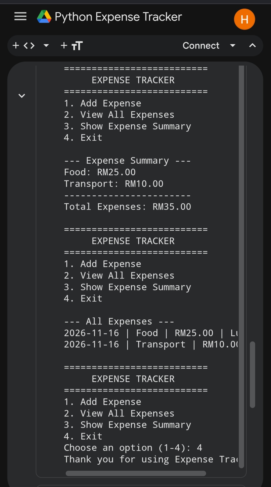
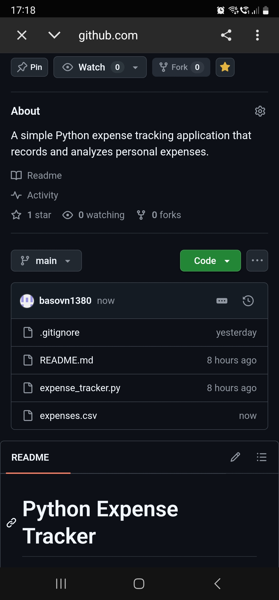

# Python Expense Tracker

A simple command-line application for tracking and managing personal expenses using Python.

## Features

- Add new expenses
- View all recorded expenses
- Categorize expenses
- Calculate total expenses
- Generate expense summaries
- Save records automatically in CSV format
- Validate user input

## Technologies Used

- Python 3
- CSV module
- OS module
- Datetime module

## Installation

1. Download or clone this repository.
2. Make sure Python 3 is installed.
3. Open the project folder in your terminal.

## How to Run

Execute the following command:

```bash
python expense_tracker.py
```

## Usage

Choose an option from the main menu:

1. Add Expense
2. View All Expenses
3. Show Expense Summary
4. Exit

Follow the instructions displayed in the terminal.

## Project Structure

```text
python-expense-tracker/
│
├── expense_tracker.py
├── expenses.csv
├── .gitignore
└── README.md
```

## Author

**Nikita Basov**

Python Developer | Automation

GitHub: https://github.com/basovn1380

## License

This project is available for educational and portfolio purposes.


## Demo

### Expense Summary

The application calculates expenses by category and displays the total amount.



### Expense History

The application stores and displays recorded transactions with dates and descriptions.



## Example Results

| Category | Amount |
|---|---:|
| Food | RM25.00 |
| Transport | RM10.00 |
| **Total** | **RM35.00** |

## Author

Nikita Basov  
GitHub: https://github.com/basovn1380

